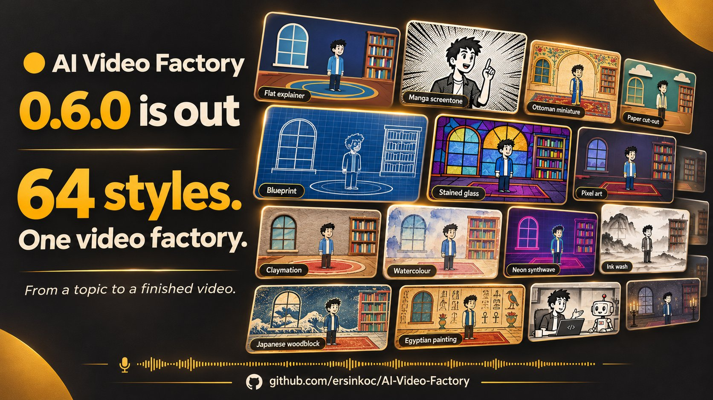

# AI Video Factory

[English](README.md) · **Türkçe**

[](LICENSE) [](https://github.com/ersinkoc/AI-Video-Factory/releases)



Bir konudan seslendirilmiş, animasyonlu YouTube videosu üretin. Claude ajanları hikâyeyi ve senaryoyu yazar, çekimleri planlar, vektör çizimleri tasarlar ve sonucu inceler. Medya sağlayıcıları ses, görsel ve klipleri üretir; Remotion son videoyu render eder. Web Stüdyo süreci görünür kılar, onayları size bırakır.

[Dokümanlar](docs/README.md) · [Başlangıç](docs/GETTING_STARTED.md) · [Stüdyo rehberi](docs/STUDIO.md) · [CLI rehberi](docs/CLI.md) · [Sürüm geçmişi](CHANGELOG.md)

## Neler yapabilirsiniz?

- **Dört görsel mod:** iskeletli vektör animasyon, hareketli sabit görseller, görsel ve AI klip karışımı veya tamamen üretilmiş klipler.
- **64 stil paketi:** tutarlı palet, çizim kuralları ve dokular; yeniden kullanılabilen karakterler, sunucular ve seri ayarları.
- **Birden fazla dilde seslendirilmiş video:** eşzamanlı altyazı, dudak hareketi, müzik ve ses efektleri. Stüdyo Türkçe ve İngilizce kullanılabilir.
- **Yayın paketi:** video, `.srt` altyazı, başlık, açıklama, bölümler, etiketler, kapak görseli ve yatay bölümlerden dikey Short.
- **Üretim boyunca inceleme:** senaryo/konsept onayları, çekim önizlemeleri, çizim denetimleri, seçili çekimleri yenileme ve çıktı denetimleri.
- **Kaldığı yerden süren, maliyeti izlenen üretim:** aşama kaydı, üretim önbelleği, yedek sağlayıcı ve ücretli çağrılardan önce tahmin.

Bölüm bütçesi ücretli görsel, ses ve video API'lerini sınırlar. Claude ajan kullanımı ayrı izlenir ve bu sınırı aşabilir. Ayrıntılar [Üretim özellikleri](docs/FEATURES.md) rehberinde.

## Hızlı başlangıç

**Node.js 24+**, **pnpm 11**, **FFmpeg** ve oturum açılmış bir Claude Code kurulumu ya da `ANTHROPIC_API_KEY` gerekir. Kullanacağınız ses, görsel ve video servislerinin anahtarlarını ekleyin. Docker isteğe bağlıdır.

```sh
git clone https://github.com/ersinkoc/AI-Video-Factory.git
cd AI-Video-Factory
pnpm install
cp .env.example .env
```

PowerShell'de son adım için `Copy-Item .env.example .env` kullanın. `.env` dosyasına anahtarlarınızı girin; anahtarı boş sağlayıcılar devre dışı kalır. Ardından Stüdyo'yu başlatın:

```sh
pnpm studio
```

**<http://localhost:3100>** adresini açın, bir bölüm oluşturun ve üretimden önce senaryo ile konsepti inceleyin. Tarayıcıda akıcı bölüm oynatımı için `pnpm studio:build`, ardından `pnpm studio:start` kullanın.

Kurulumu incelemek veya ücretli API çağrısı yapmadan yerel render denemek için:

```sh
pnpm ys doctor
pnpm ys render-demo
```

Demo, önizleme onayında durur; render'ı tamamlamak için [demo adımlarını](docs/CLI.md#local-render-demo) izleyin.

Varlıklar, maliyet defteri ve bölümler varsayılan olarak `.data` altında tutulur. Stüdyo'da giriş sistemi yoktur ve `127.0.0.1` üzerinde çalışır; ağ erişimini güvendiğiniz kişilerle sınırlayın. Yapılandırma için [Başlangıç](docs/GETTING_STARTED.md), ağ ayarları için [Stüdyo erişimi](docs/STUDIO.md#start-and-access) rehberine bakın.

## CLI ile bölüm oluşturma

```sh
pnpm ys episode new --topic "Ottoman coffeehouse bans" --lang en --minutes 3 --motion vector --budget 5 --manual
```

Komutun döndürdüğü bölüm kimliğini kullanın:

```sh
pnpm ys episode run <id>
pnpm ys episode show <id>
```

`--manual` onay kapılarında durur. Üretim, yapılandırdığınız Claude hesabını ve medya sağlayıcılarını kullanır. Onaylar, seçenekler, yeniden deneme ve karakter kullanımı [CLI rehberinde](docs/CLI.md) açıklanır.

## Dokümanlar

Ayrıntılı rehberler İngilizce tutulur; proje planı Türkçedir.

| Yapmak istediğiniz | Rehber |
| --- | --- |
| Kurmak, yapılandırmak veya güncellemek | [Başlangıç](docs/GETTING_STARTED.md) |
| Tarayıcıda bölüm oluşturmak ve düzenlemek | [Stüdyo](docs/STUDIO.md) |
| Üretimi terminalden yönetmek | [CLI](docs/CLI.md) |
| Stilleri, animasyonu ve üretim davranışını incelemek | [Üretim özellikleri](docs/FEATURES.md) |
| Düzenleme, kaynak ve kalite denetimi araçlarını bulmak | [Doküman dizini](docs/README.md) |
| Kod tabanı veya sürümler üzerinde çalışmak | [Geliştirme](docs/DEVELOPMENT.md) |

Mimari kararlar ve planlanan işler [proje planında](docs/PROJE_PLANI.md), sürüm geçmişi [değişiklik günlüğünde](CHANGELOG.md) yer alır.

## Sponsor

[**WrongStack**](https://wrongstack.com) — proje hafızasını oturumlar arasında koruyan, açık kaynaklı AI kodlama ajanı. [Web sitesi](https://wrongstack.com) · [GitHub](https://github.com/WrongStack/WrongStack)

## Lisans

[MIT](LICENSE) © 2026 Ersin KOÇ. Üçüncü taraf bileşenler, üretilen medya ve referans varlıklar kendi koşullarına tabidir; [Remotion lisansını](https://github.com/remotion-dev/remotion/blob/main/LICENSE.md), medya sağlayıcınızın koşullarını ve her varlığın kaynak lisansını inceleyin.
