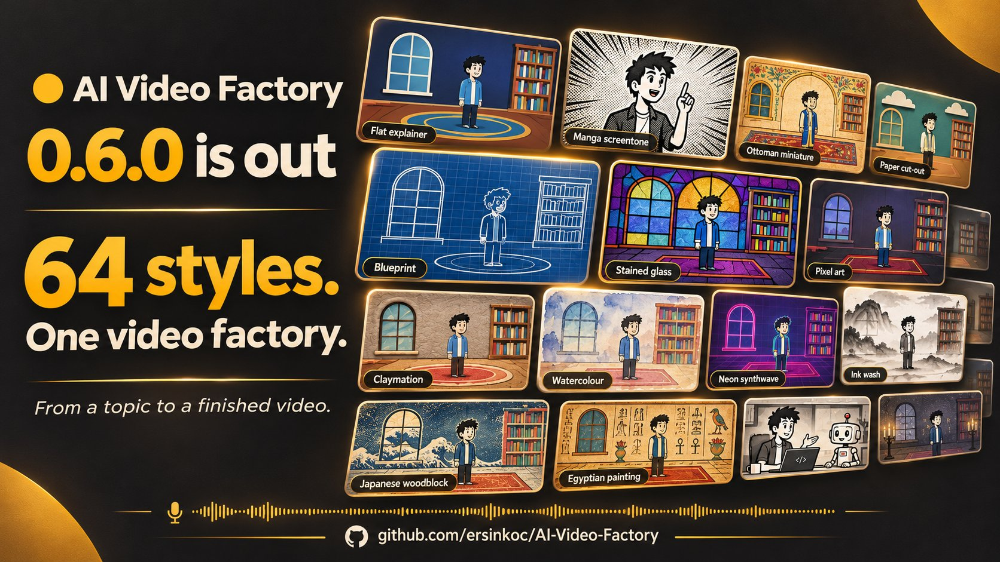

# AI Video Factory

[English](README.md) · **Türkçe**

[](LICENSE) [](https://github.com/ersinkoc/AI-Video-Factory/releases)



Bir konudan seslendirilmiş, animasyonlu YouTube videosu üretin. Claude ajanları hikâyeyi ve senaryoyu yazar, çekimleri planlar, vektör çizimleri tasarlar ve sonucu inceler. Medya sağlayıcıları ses, görsel ve klipleri üretir; Remotion son videoyu render eder. Aynı fabrika kendi görüntünüzden ya da bir YouTube videosundan dikey Short keser ve bir briften hareketli grafik filmi yapar. Web Stüdyo süreci görünür kılar, onayları size bırakır.

[Dokümanlar](docs/README.md) · [Başlangıç](docs/GETTING_STARTED.md) · [Stüdyo rehberi](docs/STUDIO.md) · [CLI rehberi](docs/CLI.md) · [Sürüm geçmişi](CHANGELOG.md)

## Neler yapabilirsiniz?

- **Dört görsel mod:** iskeletli vektör animasyon, hareketli sabit görseller, görsel ve AI klip karışımı veya tamamen üretilmiş klipler.
- **64 stil paketi:** tutarlı palet, çizim kuralları ve dokular; yeniden kullanılabilen karakterler, sunucular ve seri ayarları.
- **Birden fazla dilde seslendirilmiş video:** eşzamanlı altyazı, dudak hareketi, müzik ve ses efektleri. Stüdyo Türkçe ve İngilizce kullanılabilir.
- **Yayın paketi:** video, `.srt` altyazı, başlık, açıklama, bölümler, etiketler, kapak görseli ve yatay bölümlerden dikey Short.
- **Kendi görüntünüzden Short:** video ve fotoğraflarınızı yükleyin, süreyi seçin (15–180 sn); AI anlatımla ya da orijinal konuşmayla, altyazı, ekran yazıları, müzik ve efektle 9:16 bir Short kurgular.
- **Hareketli grafik filmi:** bir brif, marka renkleri ve logodan, sentezlenen müziğin vuruşuna kesilen kinetik yazı, grafik, diyagram, kart montajı, parçacık alanı ve 3D nesneden bir film; insan ve çizim yok, anlatım isteğe bağlı, 16:9 ya da 9:16.
- **YouTube videosundan Short:** uzun bir videonuz sahne sahne incelenip sahne günlüğü, kesilecek yerler ve sıralı Short adaylarına dönüşür; seçtikleriniz dikey Short olur.
- **ACP ile istediğiniz model:** Claude'un yanında her ajan, Antigravity (`agy`) gibi bir Agent Client Protocol ajanında ve onun Gemini, Claude ya da GPT-OSS modelleriyle çalışabilir; seçim Modeller sayfasında ajan başına yapılır. Bütün ajanları böyle çalışan anlatımsız bir hareketli grafik filmi hiçbir ücret doğurmaz.
- **Üretim boyunca inceleme:** senaryo ve konsept onayları, çekim önizlemeleri ve çizim denetimleri. Render'dan önce her kare bir kontrol listesiyle denetlenir ve 8/10 almalıdır; barajın altındaki sahneler yeniden planlanır, altında kalan sahne varken render onayınızı bekler. Seçili çekimleri bir notla yeniden yaptırabilir, bölümü render etmeden tarayıcıda oynatabilirsiniz.
- **Kaldığı yerden süren, maliyeti izlenen üretim:** aşama kaydı, üretim önbelleği, yedek sağlayıcı ve ücretli çağrılardan önce tahmin.

Her türün ne istediği, hangi adımlardan geçtiği ve ne verdiği [Bölüm türleri](#bölüm-türleri) altında. Bölüm bütçesi ücretli görsel, ses ve video API'lerini sınırlar. Claude ajan kullanımı ayrı izlenir ve bu sınırı aşabilir. Ayrıntılar [Üretim özellikleri](docs/FEATURES.md) rehberinde.

## Hızlı başlangıç

**Node.js 24+**, **pnpm 11**, **FFmpeg** ve oturum açılmış bir Claude Code kurulumu ya da `ANTHROPIC_API_KEY` gerekir. Kullanacağınız ses, görsel ve video servislerinin anahtarlarını ekleyin. Docker isteğe bağlıdır.

```sh
git clone https://github.com/ersinkoc/AI-Video-Factory.git
cd AI-Video-Factory
pnpm install
cp .env.example .env
```

PowerShell'de son adım için `Copy-Item .env.example .env` kullanın. `.env` dosyasına anahtarlarınızı girin; anahtarı boş sağlayıcılar devre dışı kalır. Ardından Stüdyo'yu başlatın:

```sh
pnpm studio
```

**<http://localhost:3100>** adresini açın, bir bölüm oluşturun ve üretimden önce senaryo ile konsepti inceleyin. Tarayıcıda akıcı bölüm oynatımı için `pnpm studio:build`, ardından `pnpm studio:start` kullanın.

Kurulumu incelemek veya ücretli API çağrısı yapmadan yerel render denemek için:

```sh
pnpm ys doctor
pnpm ys render-demo
```

Demo, önizleme onayında durur; render'ı tamamlamak için [demo adımlarını](docs/CLI.md#local-render-demo) izleyin.

Varlıklar, maliyet defteri ve bölümler varsayılan olarak `.data` altında tutulur. Stüdyo'da giriş sistemi yoktur ve `127.0.0.1` üzerinde çalışır; ağ erişimini güvendiğiniz kişilerle sınırlayın. Yapılandırma için [Başlangıç](docs/GETTING_STARTED.md), ağ ayarları için [Stüdyo erişimi](docs/STUDIO.md#start-and-access) rehberine bakın.

## Bölüm türleri

Stüdyo'da **Yeni bölüm** sayfasının dört sekmesi var: **Konudan bölüm**, **Kendi görüntünden Short**, **YouTube'dan** ve **Hareketli grafik filmi**. Her biri farklı girdi alır ve farklı bir şey üretir. Her sekmenin CLI karşılığı kendi açıklamasının sonunda. `episode new` bölüm kimliğini yazdıktan sonra `pnpm ys episode run <kimlik>` ile çalıştırın, `pnpm ys episode show <kimlik>` ile durumuna bakın.

### Konudan bölüm

Herhangi bir konuda seslendirilmiş, görselli bir video; 16:9 ya da 9:16.

**Verdikleriniz**
- **Konu:** tek zorunlu alan.
- **Seri:** isteğe bağlı. Var olan bir seriyi seçerseniz son bölümünün ayarları kopyalanır ve karakterleri öne çıkar.
- **Görsel mod:**
  - *Vektör çizim:* Claude karakterleri, mekânları ve nesneleri SVG olarak çizer, kod canlandırır. Görsel ya da video API'si kullanılmaz.
  - *Canlı resim + efekt:* kamera hareketli üretilmiş görseller.
  - *Karışık:* sabit görseller ve belli bir oranda AI video klipleri.
  - *Tamamen animasyon:* her çekim bir AI klip.
- **Stil:**
  - **Stil paketi:** *Otomatik*, 64 paketten biri ya da *Özel*.
  - **Stil ipucu:** isteğe bağlı serbest metin.
  - **Çizgi stili:** kalın kontur, konturksuz düz, el çizimi ya da mürekkep. Yalnız vektör modda.
  - **Karakter bankasından karakterler:** bir sunucu ve en çok beş oyuncu. Yalnız vektör modda.
- **Dil ve ses:**
  - **Dil:** Türkçe, İngilizce, İspanyolca, Brezilya Portekizcesi, Almanca, Fransızca, Arapça, Hintçe, Japonca ya da Endonezce.
  - **Anlatıcı sesi.**
- **Süre:** formda 1–20 dakika, varsayılan 3.
- **Maliyet:**
  - **Kalite seviyesi:** ekonomi, standart ya da premium.
  - **Bütçe sınırı:** dolar olarak; ücretli görsel, ses ve video API'leri için.
- **Anahtarlar:**
  - Dikey 9:16.
  - Videoya basılı altyazı.
  - Kare denetimi.
  - Gerçeklik denetimi: gerçek şeyler internetteki referanslardan çizilir.
  - Arka plan müziği ve ses efektleri.
  - Yatay bölümden dikey Short.
  - Yalnız vektör modda:
    - yürürken yandan görünüm;
    - sık kullanılan odaların ters açısı;
    - set dekoru: boş odalara mobilya parçaları ekler.

**Adımlar** (✋ üretimin sizi beklediği yerler)
1. Stil seçilir. Ajanlar hikâyeyi araştırıp senaryoyu yazar.
2. ✋ **Senaryoyu onaylayın.** Onaydan önce anlatımı düzenleyebilirsiniz.
3. Oyuncular seçilir, konsept çizilir: karakterler, mekânlar ve nesneler. Her çizim bir kalite kapısından geçer.
4. ✋ **Konsepti onaylayın.** Çizimleri reddedebilir, karakterleri değiştirebilirsiniz.
5. Üretim sırayla ilerler:
   1. anlatım ve kelime zamanlaması;
   2. çekim planları;
   3. çizimler ya da ana kareler;
   4. klipler;
   5. zaman çizelgesi, müzik ve ses efektleri.
6. Taslak kare denetimi her çekimi bir kontrol listesiyle puanlar. 8/10'un altındaki sahneler en çok üç turda yeniden planlanır.
7. ✋ **Önizlemeyi onaylayın.** Render etmeden tarayıcıda izleyebilir ya da seçtiğiniz çekimleri bir notla yeniden yaptırabilirsiniz.
8. Render, yayın paketi, Short ve son inceleme.

**Aldıklarınız**
- MP4;
- `.srt` altyazı;
- 1280×720 kapak görseli;
- başlık, açıklama, bölümler, etiketler ve hashtag'lerle `<kimlik>.youtube.txt` paketi;
- yatay bölümden 9:16 `<kimlik>.short.mp4`;
- her çekim için inceleme raporu.

**Maliyet**
- Claude ajanları.
- Anlatım (TTS).
- Canlı resim, karışık ve tamamen animasyon modlarında bir görsel API'si.
- Karışık ve tamamen animasyon modlarında bir video API'si.

Vektör mod görsel ya da video API'si kullanmaz. Stüdyo başlamadan önce bir tahmin gösterir.

**CLI'dan**

```sh
pnpm ys episode new --topic "Osmanlı'da kahvehane yasakları" --lang tr --minutes 3 --motion vector --budget 5 --manual
```

| Seçenek | Değerler |
| --- | --- |
| `--motion` | `vector`, `still`, `mixed` ya da `animated`. Verilmezse mod `still`, `--clips` 0'dan büyükse `mixed` olur. |
| `--clips` | AI klip oranı, 0–1. |
| `--tier` | Varsayılan `economy`. |
| `--budget` | Varsayılan 10. |
| `--lang` | Varsayılan `tr`. |
| `--minutes` | Varsayılan 3. |
| `--voice` | Anlatıcı sesi. |
| `--style` | Stil ipucu. |
| `--style-pack` | `auto`, `custom` ya da bir paket kimliği. |
| `--line` | Çizgi stili. |
| `--presenter` | Karakter bankası kimliği. |
| `--with` | Virgülle ayrılmış karakter bankası kimlikleri. |
| `--series` | Seri adı. |
| `--vertical` | 9:16 bölüm üretir. |
| `--no-captions`, `--no-qa`, `--no-realism`, `--no-reverse-views`, `--no-set-dressing` | İlgili anahtarı kapatır. |
| `--side-views` | Yürürken yandan görünümü açar. |
| `--manual` | Her onayda durur. |

`--manual` olmadan CLI senaryoyu ve konsepti kendisi onaylar. Ancak barajın altında sahne kaldıkça render yine bekler.

### Kendi görüntünden Short

Kendi videolarınızdan ve fotoğraflarınızdan kurgulanan dikey bir Short (1080×1920).

**Verdikleriniz**
- **Dosyalar:** en çok 20 video ve görsel (mp4, mov, webm, mkv, m4v, jpg, jpeg, png, webp). Seçtikçe yüklenir.
- **Kısa bilgi:** isteğe bağlı.
- **Ekran yazıları:** en çok 60 karakterlik 8 satır.
- **Süre:** 15–180 saniye, varsayılan 30.
- **Dil, ses ve bütçe.**
- **Anahtarlar:**
  - *AI anlatımı:* kapalıyken yalnız orijinal ses kalır.
  - *Konuşma dökümü:* orijinal konuşma altyazı olur ve kurguya yardım eder.
  - Videoya basılı altyazı.
  - Arka plan müziği ve ses efektleri.

**Adımlar**
1. Her dosya taranır: her videodan kareler, konuşma dökümü açıksa kelime zamanlı döküm.
2. Kurgu ajanı kareleri ve dökümü görüp kurguyu yazar:
   - her biri kaynak aralığı, kırpma odağı, kadrajı ve sesiyle bir ila dört parçalık vuruşlar;
   - isteğe bağlı anlatım;
   - sizin ekran yazılarınız.
3. ✋ **Kurguyu onaylayın.** Senaryo sekmesinde şunları değiştirebilirsiniz:
   - vuruş ve parça sırası, istediğinizi çıkararak;
   - giriş ve çıkış noktaları;
   - kırpma odağı ve kadraj;
   - ses, duygu ve yazılar.
4. Ardından:
   1. anlatım;
   2. hedef süreye zamanlama;
   3. kesilmiş özneyi ortalayan kadraj denetimiyle 9:16 kesimler;
   4. müzik ve ses efektleri.
5. ✋ **Önizlemeyi onaylayın.**
6. Render ve yayın paketi.

**Aldıklarınız**
- dikey MP4;
- `.srt` altyazı;
- Short'un kendisinden bir kapak karesi;
- `<kimlik>.youtube.txt` paketi.

**Maliyet**
- Claude ajanları.
- Anlatım (TTS), yalnız açıksa.
- Konuşmadan metne, yalnız döküm açıksa: ElevenLabs Scribe ile saati yaklaşık 0,40 $, yerel whisper.cpp ile ücretsiz (`YS_WHISPER`, `YS_WHISPER_MODEL`).

**CLI'dan**

```sh
pnpm ys episode new --footage gezi.mp4 --footage gundogumu.jpg --sec 30 --overlay "Hayatımın sabahı" --manual
```

- Her dosya için `--footage`, her yazı için `--overlay` tekrarlanır.
- `--topic` kısa bilgidir.
- `--no-narration`, `--no-transcribe`, `--no-captions` ve `--no-qa` ilgili anahtarı kapatır.
- `--budget` varsayılanı 5.

### YouTube'dan

Sahibi olduğunuz uzun bir videonun analizi; ardından onu dikey Short'lara dönüştürürsünüz. [yt-dlp](https://github.com/yt-dlp/yt-dlp) gerekir.

**Verdikleriniz**
- **YouTube adresi:** videonun haklarına sahip olduğunuzu onaylarsınız.
- **Not:** isteğe bağlı.
- **Aday sayısı:** 1–12, varsayılan 6.
- **En kısa ve en uzun Short:** 15–180 saniye, varsayılan 20 ve 60.
- **Dil ve bütçe:** dil, rapor ve yazılar içindir.
- **Anahtarlar:**
  - *Konuşma tanıma:* yalnız videonun altyazısı yoksa kullanılır.
  - Short'lar için basılı altyazı, arka plan müziği ve ses efektleri.

90 dakikaya kadar videolar kabul edilir (`YS_YOUTUBE_MAX_MIN`).

**Adımlar**
1. Video en çok 1080p indirilir ve kütüphanede tutulur; ikinci bir analiz ya da Short'lar onu yeniden kullanır.
2. Döküm videonun altyazısından alınır: önce konuşulan dildeki elle yazılmış altyazı. Hiç yoksa konuşma tanıma çalışır.
3. Sahne geçişleri ve sessizlikler bulunur, her sahneden kareler alınır.
4. Analist ajanı videoyu altışar dakikalık pencerelerle, temas sayfaları ve döküm üzerinden inceler. Ardından seçici ajan Short adaylarını sıralar.
5. Aday sınırları kelime sınırlarına oturtulur ve süre sınırlarınızın içinde tutulur.

Onay da render da yok: sonuç bir rapordur.

**Aldıklarınız**

Bölümün **Analiz** sekmesi şunları gösterir:
- kancası, puanı ve YouTube'daki o ana bağlantılarıyla sıralı Short adayları;
- enerji ve kaliteyle sahne günlüğü;
- kesilmeye değer kısımlar ve nedenleri.

Adayları seçip **Seçilenlerden Short üret** düğmesine basın. Her biri bir "Kendi görüntünden Short" bölümü olur:
- orijinal konuşma basılı altyazı olarak;
- kanca bir ekran yazısı olarak;
- render'dan önce kendi onayı.

**Maliyet**
- Analist ve seçici için Claude ajanları.
- Konuşmadan metne, yalnız videonun altyazısı yoksa.

**CLI'dan**

```sh
pnpm ys episode new --youtube https://www.youtube.com/watch?v=<kimlik> --count 6 --min 20 --max 60
pnpm ys episode run <kimlik>
pnpm ys episode shorts <kimlik> --candidates c1,c3
```

- `episode new --youtube` ayrıca `--no-transcribe` ve `--no-captions` alır.
- `episode shorts`, her Short'u üretilmeden önce Stüdyo'da düzenlemek için `--review`, ayrıca `--no-music` alır.

### Hareketli grafik filmi

İnsan figürü ve çizim olmadan, vuruşa oturan yazı, veri ve şekillerden oluşan kısa bir marka ya da anlatım filmi.

**Verdikleriniz**
- **Brif:** filmin rakamlar için tek kaynağı. Brifte olmayan bir grafik ya da kart rakamı "temsili veri" rozeti taşır.
- **Süre:** 10–180 saniye, varsayılan 30.
- **En-boy:** 16:9 ya da 9:16.
- **Dil ve bütçe.**
- **Marka renkleri:** en çok altı onaltılık kod.
- **Logo ve ekran görüntüleri:** en çok 12 görsel.
- **Anlatım:** varsayılan kapalı. Açıksa bir ses seçin; altyazı da onu izler.
- **Anahtarlar:** arka plan müziği ve ses efektleri.

**Film nelerden oluşur**
- **Kinetik yazı:** vurgu haplarıyla slam, rise, kelime kelime ya da bölüm kartı.
- **Veri:**
  - sıfırdan çizilen çubuklar ve çizgiler;
  - sayan sayaçlar;
  - bir değeri gösteren notlar.
- **Sistem diyagramları:** bağlantılar çizilerek gelir, üzerlerinde paketler yol alır.
- **Kartlar:** vuruşta kesilen kart ızgaraları ve tam ekran montajlar.
- **Parçacık alanları.**
- **Basit 3D nesneler:** logonuzu taşıyabilir.
- **Ritim:**
  - tek tempo (88–140 BPM), kanca, yükseliş, duruş, doruk ve çözülme bölümlerinden bir ritim çizelgesi;
  - vuruşta geçişler;
  - görüntüye kilitli sentezlenmiş müzik ve ses efektleri.

**Adımlar**
1. Yönetmen ajanı filmin tamamını tek çağrıda veri olarak yazar. Yazdığı kod çalıştırılmaz.
2. Kod ritmi (3 saniyede kanca, uzun boşluk yok, yeterli kesme) ve her yazının okunma süresini denetler; bulguları yönetmene bir kez geri gönderir.
3. ✋ **Senaryoyu onaylayın.** Senaryo sekmesinde ritim çizelgesi, sahneler ve bulgular görünür. *Notla yeniden yaz* yönetmenden yeni bir sürüm ister.
4. Anlatım varsa zamanlama ona oturtulur. Ardından zaman çizelgesi, müzik ve ses efektleri hazırlanır.
5. Her sahnenin bir önizleme karesi olur; kare denetimi 10 üzerinden puanlar. Anlatımsız filmde 8/10'un altındaki sahneler bir kez yönetmene döner. Düzeltme yalnız kareler iyileşir ve ritim kötüleşmezse tutulur.
6. ✋ **Önizlemeyi onaylayın.**
7. Render, yayın paketi ve 16:9 filmden dikey bir Short.

**Aldıklarınız**
- MP4, 1920×1080 ya da 1080×1920;
- filmden bir kapak karesi;
- `<kimlik>.youtube.txt` paketi;
- anlatım varsa `.srt` altyazı;
- 16:9 filmden 9:16 Short.

**Maliyet**
- Bir yönetmen çağrısı ve kare denetimi: Claude ya da ACP ile ücretsiz.
- Anlatım (TTS), yalnız açıksa.

Ajanları `agy` gibi bir ACP ajanında çalışan anlatımsız bir film hiçbir ücret doğurmaz.

**CLI'dan**

```sh
pnpm ys episode new --film --topic "Relay dağıtımları 40 dakikadan 12'ye indiriyor" --sec 30 --color "#2563eb" --asset logo.png
pnpm ys episode run <kimlik>
```

- `--vertical` 9:16 film üretir.
- `--color` ve `--asset` gerektiği kadar tekrarlanır.
- `--narration` anlatımı açar, `--voice` sesi seçer.
- `--no-captions` ve `--no-qa` ilgili anahtarı kapatır.
- `--budget` varsayılanı 5.

### Modeller

Yukarıdaki her ajan Claude'da ya da bir ACP ajanında çalışabilir; seçim Stüdyo'nun **Modeller** sayfasında ajan başına yapılır. Onaylar, yeniden deneme, `--until`/`--from`/`--only` ile aşama çalıştırma ve karakter kullanımı [CLI rehberinde](docs/CLI.md) açıklanır.

## Dokümanlar

Ayrıntılı rehberler İngilizce tutulur; proje planı Türkçedir.

| Yapmak istediğiniz | Rehber |
| --- | --- |
| Kurmak, yapılandırmak veya güncellemek | [Başlangıç](docs/GETTING_STARTED.md) |
| Tarayıcıda bölüm oluşturmak ve düzenlemek | [Stüdyo](docs/STUDIO.md) |
| Üretimi terminalden yönetmek | [CLI](docs/CLI.md) |
| Stilleri, animasyonu ve üretim davranışını incelemek | [Üretim özellikleri](docs/FEATURES.md) |
| Düzenleme, kaynak ve kalite denetimi araçlarını bulmak | [Doküman dizini](docs/README.md) |
| Kod tabanı veya sürümler üzerinde çalışmak | [Geliştirme](docs/DEVELOPMENT.md) |
| 3D, WebGL ya da shader işi eklemek, kodlama oturumları için isteğe bağlı 3D skill'lerini kurmak | [3D referansları](docs/3D_REFERENCES.md) (İngilizce) |

Mimari kararlar ve planlanan işler [proje planında](docs/PROJE_PLANI.md), sürüm geçmişi [değişiklik günlüğünde](CHANGELOG.md) yer alır.

## Sponsor

[**WrongStack**](https://wrongstack.com) — proje hafızasını oturumlar arasında koruyan, açık kaynaklı AI kodlama ajanı. [Web sitesi](https://wrongstack.com) · [GitHub](https://github.com/WrongStack/WrongStack)

## Lisans

[MIT](LICENSE) © 2026 Ersin KOÇ. Üçüncü taraf bileşenler, üretilen medya ve referans varlıklar kendi koşullarına tabidir; [Remotion lisansını](https://github.com/remotion-dev/remotion/blob/main/LICENSE.md), medya sağlayıcınızın koşullarını ve her varlığın kaynak lisansını inceleyin.
