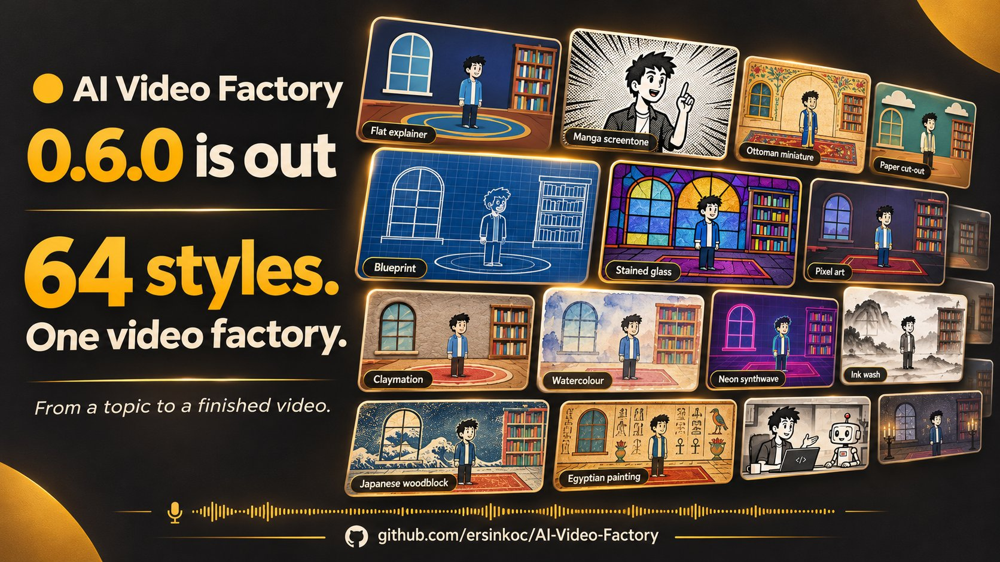

# AI Video Factory

**English** · [Türkçe](README-TR.md)

[](LICENSE) [](https://github.com/ersinkoc/AI-Video-Factory/releases)



Turn a topic into a narrated, animated YouTube video. Claude agents write the story and script, plan shots, design vector art and review the result. Media providers supply voice, images and clips; Remotion renders the final cut. The web Studio keeps the process visible and puts approvals in your hands.

[Documentation](docs/README.md) · [Getting started](docs/GETTING_STARTED.md) · [Studio guide](docs/STUDIO.md) · [CLI guide](docs/CLI.md) · [Changelog](CHANGELOG.md)

## What you can make

- **Four visual modes:** rigged vector animation, moving stills, a mix of stills and AI clips, or fully generated clips.
- **64 style packs:** consistent palettes, drawing rules and textures, with reusable characters, presenters and series settings.
- **Narrated videos in multiple languages:** synchronized captions, lip sync, music and sound effects. The Studio supports English and Turkish.
- **A publishing package:** video, `.srt` subtitles, title, description, chapters, tags, thumbnail and a vertical Short from horizontal episodes.
- **Review throughout production:** script/concept approvals, shot previews, drawing checks, selected-shot revisions and export audits.
- **Resumable, cost-aware production:** saved stage progress, generation caching, provider fallback and estimates before paid calls.

The episode budget caps paid image, voice and video APIs. Claude agent usage is tracked separately and can exceed that cap. See [Production features](docs/FEATURES.md) for the details.

## Quick start

You need **Node.js 24+**, **pnpm 11**, **FFmpeg**, and either a signed-in Claude Code installation or an `ANTHROPIC_API_KEY`. Add media-provider keys for the voice, image and video services you want to use. Docker is optional.

```sh
git clone https://github.com/ersinkoc/AI-Video-Factory.git
cd AI-Video-Factory
pnpm install
cp .env.example .env
```

In PowerShell, use `Copy-Item .env.example .env` for the last step. Fill in your keys in `.env`; providers with empty keys are disabled. Then start the Studio:

```sh
pnpm studio
```

Open **<http://localhost:3100>**, create an episode and review its script and concept before production. For smooth in-browser episode playback, use `pnpm studio:build` followed by `pnpm studio:start`.

To inspect your setup or try a local render without paid API calls:

```sh
pnpm ys doctor
pnpm ys render-demo
```

The demo pauses for preview approval; follow the [demo steps](docs/CLI.md#local-render-demo) to finish rendering.

Assets, the cost ledger and episodes are stored under `.data` by default. The Studio has no login and binds to `127.0.0.1`; keep network access limited to people you trust. See [Getting started](docs/GETTING_STARTED.md) for configuration and [Studio access](docs/STUDIO.md#start-and-access) for network setup.

## Make an episode from the CLI

```sh
pnpm ys episode new --topic "Ottoman coffeehouse bans" --lang en --minutes 3 --motion vector --budget 5 --manual
```

Use the returned episode ID:

```sh
pnpm ys episode run <id>
pnpm ys episode show <id>
```

`--manual` stops at approval gates. Generation uses your configured Claude account and media providers. The [CLI guide](docs/CLI.md) covers approvals, options, retries and character reuse.

## Documentation

| I want to… | Guide |
| --- | --- |
| Install, configure or update | [Getting started](docs/GETTING_STARTED.md) |
| Create and revise episodes in the browser | [Studio](docs/STUDIO.md) |
| Run production from the terminal | [CLI](docs/CLI.md) |
| Explore styles, animation and production behavior | [Production features](docs/FEATURES.md) |
| Find editing, source and quality-review tools | [Documentation index](docs/README.md) |
| Work on the codebase or releases | [Development](docs/DEVELOPMENT.md) |

Architecture decisions and planned work are in the [project plan](docs/PROJE_PLANI.md) (Turkish). Release history is in the [changelog](CHANGELOG.md).

## Sponsor

[**WrongStack**](https://wrongstack.com) — an open-source AI coding agent with persistent project memory. [Website](https://wrongstack.com) · [GitHub](https://github.com/WrongStack/WrongStack)

## License

[MIT](LICENSE) © 2026 Ersin KOÇ. Third-party components, generated media and reference assets retain their own terms; see the [Remotion license](https://github.com/remotion-dev/remotion/blob/main/LICENSE.md), your media providers' terms and each asset's source license.
