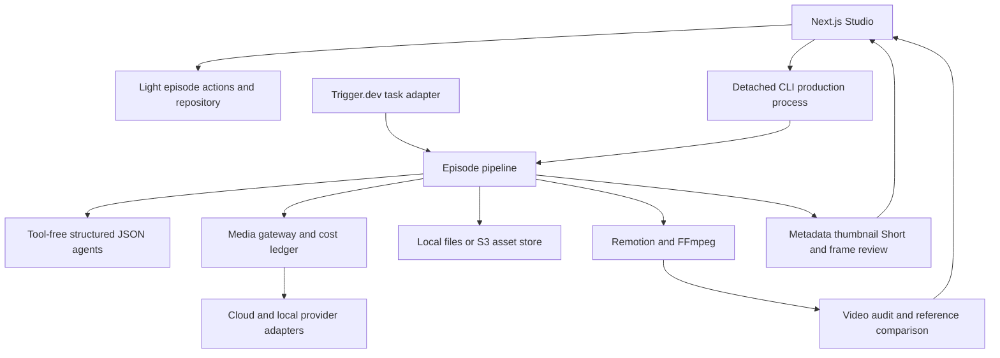

# YoutubeStudio System Review and Development Roadmap

Date: 11 November 2026

Repository: `D:\Codebox\PROJECTS\YoutubeStudio`

Source baseline: `main`, `1d8fc50f82a10ab742bb6903a651a36a9c7ed42f`, with substantial existing uncommitted work

Scope: Studio, CLI, worker, all seven packages, production stages, local episode records, verification and product direction

## Executive assessment

YoutubeStudio has a substantial production foundation: structured agents, an isolated media gateway, reusable character assets, deterministic animation, approval gates, incremental rendering, publishing assets and increasingly useful measurements of the actual export. Its strongest opportunity is to make an episode easier to direct, verify and improve with evidence.

The next investment should connect narrative intent to visible action, make quality changes measurable on a fixed sample, and close the loop between an exported video and audience response. The existing 64-style catalog provides breadth; deeper execution of the styles already used would produce a more testable improvement than another catalog expansion.

Recommended sequence:

1. Establish a representative quality baseline and an issue workflow tied to the exact rendered version.
2. Add structured narrative intent and factual sources, with precise editing and clear regeneration previews.
3. Add publishing and audience analytics in stages, starting with manual export/import compatibility.
4. Expand localization, provider optimization and distributed execution after the preceding workflows are measurable.

These are development recommendations. This review changes no production implementation and certifies no live deployment or channel outcome.

Implementation follow-up on 11 November: the first work package has since added frozen benchmark inputs and technical clips, export-bound quality decisions, and automatic Short audits. See [the implemented quality workflow](QUALITY_WORKFLOW.md). Semantic clip review and scored reviewer-noise measurement remain separate work.

## Current architecture

The actual stage sequence is `style → story → script → cast → concept → voice → shots → keyframes → clips → timeline → render → package → short → review`. Script, concept and preview approvals provide explicit human gates. CLI auto-approval and Studio approval behavior differ intentionally.

| Area | Present implementation | Practical boundary |
| --- | --- | --- |
| Studio | TR/EN forms, approvals, shot selection/recreation, character library, custom styles, costs, audit and comparison cards | The main production launcher spawns a CLI child; its job map is process-local |
| CLI | Episode lifecycle, regeneration, model/provider inspection, audit and style comparison | No implemented YouTube publisher or audience-analytics command was found in the inspected application paths |
| Worker | Trigger.dev task with retries, progress metadata and concurrency limit | Adapter/configuration exists; no deployed worker was verified |
| Core | Zod models, geometry, animation constraints, styles, typography, custom recipes and continuity helpers | Schema fields for channels and target languages do not constitute an implemented publishing/localization workflow |
| Agents | Story, writing, directing, design, quality gates, packaging and pronunciation | Structured calls have tools, skills, settings and connectors isolated |
| Media gateway | Capability routing, content cache, health tracking, media-budget reservations and billed-failure accounting | Routing uses configured quality priors; live provider prices and quality were not benchmarked in this review |
| Pipeline | Saved substeps, approval invalidation, asset reuse, review/replan loops, provenance and actual-export analysis | A large orchestration module owns many concerns; new work needs explicit dependency boundaries |
| Video | Remotion, SVG rigs, Three.js, PixiJS, GSAP, audio synthesis, chunk cache, retries and resource limits | Technical measurements and still critiques do not establish complete editorial quality |
| Storage and DB | Local/S3 storage, conditional lock ownership, JSONL or PostgreSQL cost ledger | Local episode state remains file/object based; DB episode tables are not the primary production repository |
| Publishing assets | Title, description, chapters, tags, thumbnail, SRT and one derived Short | Creation of these assets is separate from uploading, scheduling and measuring a published video |

Sources: [stage and state contracts](../packages/pipeline/src/state.ts), [pipeline](../packages/pipeline/src/pipeline.ts), [Studio launcher](../apps/studio/src/lib/server.ts), [worker](../apps/worker/src/episode.ts), [agent isolation](../packages/agents/src/runner.ts), [gateway](../packages/media-gateway/src/gateway.ts), [database schema](../packages/db/src/schema.ts).

## Evidence from the local library

The following is a read-only inventory of local records, collected during this review. It is historical operational evidence, not a fresh editorial review of the videos.

| Observation | Value | Interpretation |
| --- | --- | --- |
| Episode state files | 49 | Includes development and historical material; not a count of published episodes |
| Total state-file bytes | 65,652,322 | About 62.6 MiB across the local library |
| Episodes with a render record | 49 | A record alone does not establish a healthy or current MP4 |
| Referenced render paths present | 47 | Two recorded paths were absent at inspection time; this does not establish deletion or data corruption |
| Planned shots | 2,122 | Useful pool for selecting representative quality cases |
| Stored shot-review scores | 1,896 | Historical critic outputs, potentially from different code/model versions |
| Mean stored critic score | 4.75/10 | A prioritization signal, not a current quality benchmark |
| Completed review markers | 43 | Stored completion status, not a new completeness audit |
| Main renders with an audit record | 4 | Recent measurement features have limited coverage in this local history |
| Main renders with a style-comparison record | 0 | The feature exists; local adoption is not demonstrated by these records |
| Explicit motion modes | 46 vector, 1 still, 2 legacy/default | Optimize the vector workflow first; retain smoke coverage of other modes |
| Style catalog entries | 64 | Catalog breadth does not imply equivalent material behavior or visual validation |

Most frequent stored issue types:

| Issue type | Recorded occurrences |
| --- | ---: |
| `off_story` | 1,043 |
| `other` | 932 |
| `wrong_scale` | 674 |
| `empty` | 511 |
| `repetitive` | 424 |
| `character_cut_off` | 364 |
| `cluttered` | 317 |
| `text_overlap` | 299 |
| `unreadable_text` | 286 |

Counts represent issue occurrences; a shot can have multiple issues, including multiple entries of the same type. Older findings may already be addressed by newer rendering code. The broad `other` bucket also reduces diagnostic value. A calibrated, versioned benchmark is necessary before treating these counts as current defect rates.

Reproduction: [evidence collector](../.temp_files/system-review-2026-11-11/collect-evidence.ps1) and [collected JSON](../.temp_files/system-review-2026-11-11/evidence.json). These local evidence files contain aggregate counts and source hashes, without episode subjects or credentials.

## Capabilities to preserve

- Keep paid generation behind the gateway. Its cache, fallback rules and budget accounting are central to predictable production.
- Keep absolute-frame animation and seeded variation. Remotion explicitly requires frames to remain independent of evaluation order; lowering concurrency cannot repair a wall-clock animation contract. [Remotion rendering guidance](https://www.remotion.dev/docs/flickering)
- Keep the incremental picture/audio cache, conservative render concurrency, retry classification and machine render lock. Measure changes against both cold and warm renders.
- Keep runtime agents as isolated JSON producers. Research, tool use and external engines should be explicit orchestration jobs that supply bounded inputs to these agents.
- Preserve immutable custom styles, frozen export references, archive provenance and old-timeline compatibility.
- Preserve the distinction between complete measurements, advisory findings, skipped checks and editorial approval.
- Keep the existing style catalog and reusable characters while improving material treatment and narrative direction.

The HyperFrames exporter remains a development fixture. Native Remotion scene output, hosted external projects and rendered media have different editability and deployment requirements. No automatic external-engine production should be inferred from installed skills or the fixture. See [scene engine boundaries](SCENE_MOTION.md).

## Highest priority improvements

Effort estimates below are planning ranges for one experienced developer familiar with this repository: S = approximately 1–3 working days, M = 4–8, L = 9–15+. They exclude provider approval, data collection and substantial new design work. They are not delivery commitments.

### 1 Establish a quality benchmark with rendered clips

**Priority: P0 · Effort: M**

Extend the existing `pnpm bench` workflow rather than building a second scoring system. It already selects fixed shots, renders stills and compares critic outputs. Add a small fixed clip set covering action, reading holds, text reveals, transitions, crowded scenes, macro shots, archive inserts, 3D figures and portrait framing.

Record source fingerprint, model, prompt/policy version, style, input identity, renderer settings and elapsed time. Run the same inputs twice to estimate reviewer variability. Separate deterministic geometry/readiness checks from subjective critic scores.

**Acceptance:** a candidate change is compared against the same baseline; no missing samples are counted as passes; flagged clips include timestamps; quality gains and render-time changes are shown together. Start with roughly 30 still cases and 6–10 short clips, then adjust from measured run cost.

Source: [existing benchmark](../packages/pipeline/scripts/bench.ts).

### 2 Give each shot a structured narrative purpose

**Priority: P0 · Effort: M–L**

Store the subject, narrated action, intended visible result, relevant narration interval and readable hold as supported structured fields. Optional fields should allow existing plans to remain readable. Use these fields for planning and validation, with English description parsing retained as a compatibility fallback.

For example, a shot about a student typing should identify the student, the keyboard interaction and the screen result. This gives both the renderer and reviewer a clearer target than a generic explanation gesture. The current narrated-action parser and screen-content system provide useful foundations.

**Acceptance:** a fixed case set verifies that the correct subject performs the intended action; the visible result appears during the relevant spoken line; a quiet explanatory hold remains valid. Changes to prompt policies include their wiring tests.

Sources: [narrated action](../packages/pipeline/src/narrated-action.ts), [director](../packages/agents/src/vector.ts), [motion policies](../packages/agents/src/motion-design.ts).

### 3 Unify issues around the rendered version

**Priority: P0 · Effort: M**

Combine existing lint, draft review, final review, video audit and reference-comparison results into a filterable issue view. Preserve each source and its evidence limits. Add shot/time seeking, reviewed/accepted/fix-needed decisions, and a render identity so decisions cannot silently approve a later export.

Extend actual-export audits to Shorts. Add short multi-frame review windows at important actions and cuts. The current mixed-audio measurements should retain their advisory behavior; a complete audit must never silently become final approval.

**Acceptance:** each displayed issue identifies its source and render; skipped/failed checks remain visible; approvals on an older render are visibly historical; accepted artistic choices do not trigger automatic paid regeneration.

Sources: [render audit](RENDER_AUDIT.md), [reference comparison](REFERENCE_STYLE.md), [bounded audit summary](../packages/pipeline/src/render-audit.ts).

### 4 Add factual claims and their sources

**Priority: P1 · Effort: L**

Create a research record connecting factual claims to source URLs, excerpts, dates and affected script/shot IDs. Archive provenance already records where an inserted image came from; it does not establish that the narration is true or that the image depicts the narrated event.

A separate research job can fetch and normalize evidence, then pass it to the existing isolated writers and reviewers. Distinguish documented statements, disputed accounts, estimates, quotations and illustrative reconstructions. Let an editor resolve unresolved claims before final approval.

**Acceptance:** a historical episode can export a claim/source register; important unsupported claims are visible; changing a sourced statement identifies dependent narration and visuals; missing sources are not invented by an agent.

Sources: [archive workflow](ARCHIVE_IMAGES.md), [agent schemas](../packages/agents/src/schemas.ts), [script agents](../packages/agents/src/agents.ts).

### 5 Make edits precise and their consequences visible

Follow-up (11 Nov 2026): [reviewed narration edits](NARRATION_EDITS.md) now provide an
impact preview, stale-application rejection and exact saved-revision undo. Unchanged
scene audio is preserved, and human writes share the producer lock. This is the narration
slice of this priority; shot-property editing and selective shot regeneration remain open.

**Priority: P1 · Effort: L**

Add a shot inspector for supported properties such as text, timing, camera, screen content, selected assets and audio toggles. Preserve explicit editor choices during replanning. Before regeneration, show which scenes, voice segments and downstream artifacts will change, with estimated generation cost and cache reuse.

Start from `actions.ts` and current invalidation behavior. Introduce a dependency manifest incrementally; a general-purpose nonlinear editor or wholesale orchestration rewrite would greatly expand the scope.

**Acceptance:** changing a label does not redraw a character or resynthesize unchanged narration; a regeneration preview matches the actual invalidated outputs; undo restores a saved revision; prior rendered evidence remains associated with its export.

Sources: [actions and invalidation](../packages/pipeline/src/actions.ts), [chunk keys](../packages/video/src/chunks.ts), [shot UI](../apps/studio/src/app/episodes/[id]/steps.tsx).

### 6 Measure dialogue independently of the final mix

Follow-up (11 Nov 2026): [voice stem audits](VOICE_AUDIT.md) now check current source
files, timing bounds and script/recorded/spoken/caption forms through an explicit local
job. The real-media fixture flags a silent voice beneath an energetic mixed track and
preserves intentional word gaps. These are energy/metadata checks; an editor-managed
shared pronunciation dictionary was subsequently implemented in [Pronunciation dictionaries](PRONUNCIATIONS.md),
with episode overrides, reviewed invalidation and stale-rule protection. Separately validated
speech recognition and intelligibility checks remain open.

**Priority: P1 · Effort: M**

The existing audit measures integrated loudness, peaks and shot-level total-mix energy. Music can conceal missing dialogue in those measurements. Add checks of voice stems and alignment coverage, plus a reusable pronunciation dictionary with per-episode overrides. Compare the spoken form, script form and subtitle form explicitly.

**Acceptance:** a fixture with missing speech under audible music is flagged by the voice check; intentional pauses remain valid; long-name and number cases retain correct caption spelling; intelligibility claims require listening or a suitable separately validated method.

Sources: [audio measurement limits](RENDER_AUDIT.md), [alignment](../packages/pipeline/src/align.ts), [pronunciation](../packages/pipeline/src/pronounce.ts).

### 7 Close the publishing loop in small steps

**Priority: P1 · Effort: L**

First provide a complete manual handoff bundle: video, SRT, thumbnail, metadata and provenance. Then add channel-scoped OAuth, resumable upload, persisted upload state, scheduling and explicit final publication approval. Recover an interrupted upload without creating a duplicate.

The current YouTube API supports upload metadata including privacy, publication time and synthetic-media disclosure. Set privacy explicitly and verify actual account/project behavior. The old plan's upload/quota assumptions need refreshing against current official documentation before implementation. [YouTube upload reference](https://developers.google.com/youtube/data/reference/rest/v3/videos/insert)

**Acceptance:** one approved test video is uploaded privately, an interrupted upload resumes, captions/thumbnail are linked correctly, and a repeated job does not create another video. Upload success and public publication are distinct recorded states.

Sources: [existing packaging](../packages/agents/src/package.ts), [roadmap](PROJE_PLANI.md).

### 8 Learn from viewers with explicit attribution limits

**Priority: P1 · Effort: M for import, L for API integration**

Start with imported audience-retention data associated with a known published export. Map normalized video time to scenes and beats, displaying drops, replays and the corresponding narrative context. Add API ingestion after the data model works.

YouTube exposes retention metrics associated with `elapsedVideoTimeRatio`; replays can make `audienceWatchRatio` exceed one. Preserve this interpretation and avoid assuming that every drop proves a visual defect. [YouTube Analytics metrics](https://developers.google.com/youtube/analytics/metrics)

Keep audience hypotheses separate from the current visual lesson book. Promote lessons only after repeated evidence or editorial review. Report CTR or experiment results only when supplied by an available, verified source.

**Acceptance:** an imported retention curve aligns with the frozen export, the relevant shots can be opened, and a single video's correlation never silently becomes a global creative rule.

Source: [current lesson model](../packages/pipeline/src/lessons.ts).

### 9 Show the total cost of an accepted episode

**Priority: P1 · Effort: M**

Keep the existing media cap and add an optional total production allowance covering agent calls and regeneration rounds. Expose estimated versus recorded charges, cache savings, retries, accepted minutes and human revision counts. Existing per-call agent budgets are useful but do not by themselves implement an episode-wide total cap.

For later concurrent workers, place shared reservations at the shared accounting boundary rather than relying on an in-memory reservation map across processes. Preserve billed-failure behavior and distinguish estimates from reconciled invoices.

**Acceptance:** parallel test calls and retry scenarios cannot spend a new allowance twice; the UI labels media-only and total budgets clearly; costs can be compared per accepted output minute.

Sources: [gateway reservations](../packages/media-gateway/src/gateway.ts), [ledger](../packages/media-gateway/src/ledger.ts), [agent options](../packages/agents/src/runner.ts).

### 10 Make the growing library cheap to browse and recover

**Priority: P1 · Effort: M–L**

Add small persisted episode summaries with pagination, retaining full timeline/assets for detail views. The current four-at-a-time listing reduces retained memory but still reads every state file. With approximately 62.6 MiB of local states, a summary index is a concrete next optimization; no endpoint speedup was measured here.

Provide an export/restore bundle covering state, assets, custom styles, provenance and the ledger, with hashes and missing-file diagnostics. Include path rebasing for moved libraries. A restore check should be able to explain absent render paths without declaring data corruption.

**Acceptance:** listing does not load embedded SVG timelines; old states rebuild the index; an isolated restore opens an episode and verifies required assets without changing the source library.

Sources: [repository listing](../packages/pipeline/src/actions.ts), [read behavior](STUDIO_READS.md), [storage](../packages/storage/src/index.ts).

### 11 Deepen the styles that production actually uses

**Priority: P1 · Effort: M per small validated group**

The catalog has 64 styles, while explicit native material contracts cover paper-cutout, risograph, isometric and the custom paper-poster preset. Select a few styles from actual usage and give them differentiated composition, materials, typography, motion and review specimens.

Expand the existing typography system to specialized labels, screens and bubbles where readable, while retaining glyph validation and local fonts. Evaluate title holds and contrast at target display size. Preserve quiet holds and a consistent hero; more continuous movement is not a quality metric.

**Acceptance:** each selected style has landscape/portrait samples, transition clips and a recognizable visual contract; text remains readable; the benchmark shows no new off-story or clutter problems.

Sources: [style craft](STYLE_CRAFT.md), [typography](TYPOGRAPHY.md), [style registry](../packages/core/src/styles.ts).

### 12 Make verification reproducible before scaling

**Priority: P1 · Effort: M**

Add checked-in CI using the existing commands, a documented integration target, and a small no-generation render/audit smoke fixture. The inspected checkout has no workflow under `.github/workflows`. The release script currently gates typecheck and tests, while production build and coverage are separate commands.

Pin the validation environment, record source/input fingerprints and keep generated evidence outside polling payloads. Add a dependency/environment diagnostic command for browser, FFmpeg filters, fonts, local providers and optional Manim. Review release rollback ownership before expanding its automation in a shared checkout.

**Acceptance:** a clean CI checkout runs the chosen gates; skipped integrations are identified; a deliberately broken media fixture fails its corresponding check; release evidence links the exact source to the exported test artifact.

Sources: [scripts](../package.json), [test configuration](../vitest.config.ts), [release workflow implementation](../scripts/release.ts), [media tools](../packages/video/src/tools.ts).

## Further product opportunities

| Opportunity | Concrete first version | Dependency and completion criterion |
| --- | --- | --- |
| Searchable asset library | Filter by identity, era, style, approval and source before adding embeddings | Stable metadata first; selected asset can be reused without redraw |
| True series continuity | Versioned series bible with character state, recurring facts and events | Existing series defaults/reuse remain; a later episode can cite prior established events |
| Multiple Shorts | Rank 3–5 candidate spans, let the editor choose, then recompose | Each selected Short has its own hook, readable portrait framing and audit |
| Thumbnail experiments | Generate a small set of editable alternatives and save experiment identity | Use manual YouTube handoff first; no unsupported automated Test & Compare API claim |
| Two-language production | One visual master and separate narration/text/timing layers | Validate TR/EN duration changes before adding RTL/CJK; no clipping or timing drift |
| Provider evaluation | Fixed representative requests, measured quality, price, latency and failure rates | Opt-in billed benchmark; shadow recommendations before changing routing automatically |
| Independent editorial reviewer | Review actual output with narration and minimal intent context | Multi-frame/timecoded evidence; distinguish missing action from deliberate quiet holds |
| Lesson governance | Track scope, origin, evidence and editor acceptance for each lesson | Existing style constraints win; one model complaint cannot override every future episode |
| Persistent job operations | Durable job IDs, resumable progress, cancellation and worker heartbeats | Preserve current single-machine behavior; a server restart recovers accurate job status |
| Multi-machine rendering | Explicit media staging, shared job ownership and tested storage semantics | Lease/fencing design for remote owners, cost controls and integration proof before rollout |
| Team workflows | Review assignments and owner/editor/reviewer roles | Add identity/access controls before a shared hosted deployment; current same-origin checks are not user authentication |
| State evolution | Versioned persisted-state validation and migration fixtures | Old episodes load; malformed state is diagnosable; migrations preserve source data |

Some of these exist as intentions or schema fields in [the project plan](PROJE_PLANI.md). The table describes missing workflow depth rather than counting planned fields as delivered features.

## Suggested implementation sequence

The following is a planning order, assuming one primary developer. Parallel feature development or a different channel objective would change the schedule.

| Window | Focus | Exit condition |
| --- | --- | --- |
| First 1–2 weeks | Select quality corpus, establish baseline/noise floor, unify issue identity, audit Shorts, add CI | Reproducible reports on fixed media; old and current export decisions cannot be confused |
| Weeks 3–5 | Structured narrative intent, precise edit/invalidation preview, voice-stem checks, first claim/source records | A representative episode is revised without unrelated regeneration; important claims have inspectable support |
| Weeks 6–8 | Manual publishing bundle, private upload prototype, retention import, total-cost view | One controlled end-to-end handoff with recoverable state and audience data mapped to the same export |
| Following stage | Restore workflow, summary index, selected style depth, second language | Library recovery and measured quality/cost gains are demonstrated before adding distributed complexity |

Track five measures from the same versioned corpus: accepted-shot share, human revision rounds, total cost per accepted minute, cold/warm render time, and incomplete/failed checks. Establish current baselines before setting percentage improvement promises. Audience retention and CTR belong in a separate channel-performance view with topic and audience context.

## Changes to avoid prioritizing now

- A new rendering-engine migration without a measured limitation in the current native pipeline.
- Another large batch of style names before validating the production styles in use.
- A blanket move to more expensive models without task-specific comparisons.
- Mandatory multi-machine infrastructure for the current local-first workflow.
- Automatic rejection or regeneration driven solely by motion, palette or loudness heuristics.
- A general-purpose timeline editor before the supported shot inspector and invalidation preview work well.

YouTube's current monetization guidance emphasizes substantive originality and variation. Channel-level narrative quality and distinct educational or creative value should therefore be evaluated alongside technical output. A production tool cannot establish monetization eligibility by passing render checks. [YouTube monetization policies](https://support.google.com/youtube/answer/1311392)

## Validation performed

| Check | Observed result |
| --- | --- |
| `pnpm.cmd test` | 165 files passed, 1 file skipped; 1,855 tests passed, 2 skipped; 126.39 seconds |
| `pnpm.cmd run typecheck` | Passed for the root project and Studio |
| `pnpm.cmd run studio:build` | Passed; optimized compilation, TypeScript and static-page generation completed |
| `pnpm.cmd exec tsx scripts/preview-shot-audio.ts .temp_files/system-review-2026-11-11/audio-fixture` | Passed: real six-second encoded test-pattern MP4, three shot-audio windows, expected gap/level findings, complete audit, zero model/generation ledger entries |
| Local state inventory | Read 49 state files; aggregate evidence and source fingerprints retained beside the fixture |
| Report integrity | All local report links resolve; 446 fingerprinted repository files remained unchanged between evidence collection and report verification |

The audio fixture produced five advisory findings. Its expected quiet/silent sections are intentional; a complete measurement with findings is not a failed fixture or editorial approval. Evidence: [verification JSON](../.temp_files/system-review-2026-11-11/audio-fixture/verification.json).

The full test run emitted `MaxListenersExceededWarning` for a Socket. Tests completed successfully. This warning was not traced or reproduced independently, so it is an investigation item rather than a confirmed product memory leak.

The two skipped tests belong to the explicitly enabled PostgreSQL/RustFS integration suite. `test:coverage` was not run; the configured 100% thresholds are not a measured coverage result. No standalone lint script is defined in the root package. No live provider generation, deployed Trigger.dev job, S3 compatibility certification, YouTube upload, paid model benchmark, complete new episode production or browser interaction walkthrough was performed. No full visual review of the existing episode library is claimed.

## First recommended work package

Follow-up implementation (11 Nov 2026): [quality decisions, frozen benchmarks and Short audits](QUALITY_WORKFLOW.md), [structured shot intent](SHOT_INTENT.md), and [narration claim/source records](CLAIM_SOURCES.md) now have implemented workflows and verification evidence. The claim/source phase includes editor-supplied excerpts, bounded writer context, unreviewed candidate annotations, explicit script-only rewrite, stale decisions and frozen main-export reports. Automatic source retrieval and semantic fact checking remain future work. The validation table above records the original audit snapshot; each workflow document records its later evidence separately.

Implement the quality baseline and render-specific issue workflow first, including Short audits. Use the historical off-story, scale, repetition and text findings to choose cases, then re-evaluate those cases with current code before changing behavior. This makes the following narrative, audio, style and editing improvements measurable and reduces the risk of spending production effort on attractive changes with no demonstrated benefit.
